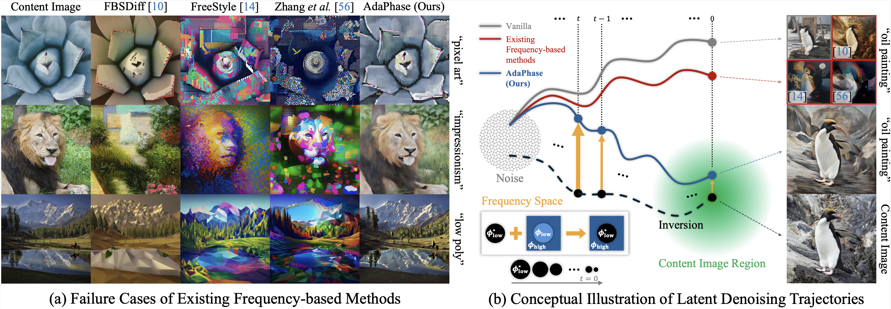

# [WACV 2027] AdaPhase: Navigating the Trajectory with Adaptive Frequency Modulation for Content-preserving Stylization
<!--### [Paper]() / [arXiv]() / [Project Page]()-->

<p align="center">
  
</p>


## Setup
### Prerequisites
AdaPhase has been tested with the following environment:
- Python 3.10
- PyTorch 2.5.1
- CUDA 12.1

An NVIDIA GPU with CUDA support is recommended for inference.

Create and activate the Conda environment:
```
conda env create -f environment.yml
conda activate adaphase
```

### Download SDXL Pretrained Model Weights
AdaPhase uses the pretrained Stable Diffusion XL (SDXL) Base and Refiner models provided by Stability AI:
- [SDXL Base 1.0](https://huggingface.co/stabilityai/stable-diffusion-xl-base-1.0)
- [SDXL Refiner 1.0](https://huggingface.co/stabilityai/stable-diffusion-xl-refiner-1.0)

The required model weights are <b>automatically downloaded from Hugging Face</b> during the first inference run
and cached in the directory specified by ```--model-cache-dir``` (default: ```./model_cache```)

Alternatively, the models can be downloaded in advance using:

```
hf download stabilityai/stable-diffusion-xl-base-1.0 \
    --cache-dir ./model_cache

hf download stabilityai/stable-diffusion-xl-refiner-1.0 \
    --cache-dir ./model_cache
```


## Run AdaPhase
To perform style transfer with AdaPhase, run:
```
python adaphase_sdxl.py \
    --content-image "./images/content_images/qual4.png" \
    --prompt "cubism" \
    --output-dir "./images/stylized_images" \
    --model-cache-dir "./model_cache" \
    --init-gaussian-lambda 0.3
```
Replace ```--content-image``` with the path to your input image and ```--prompt``` with your desired style description.

you can adjust ```--init-gaussian-lambda``` to control the balance between stylization and content preservation.

### Example Style Prompts
- <b>Traditional Arts:</b> "oil painting", "watercolor", "impressionism", "ink wash painting", "impasto painting", "sketching", "pointillism", "ukiyo-e"
- <b>Fregmented Arts:</b> "pixel art", "mosaic art", "cubism", "stained glass art"
- <b>3D & Spatial Forms:</b> "voxel art", "claymation", "low poly", "origami"
- <b>Urban & Digital Arts:</b> "cartoon", "cyberpunk", "glitch art", "graffiti painting"


## Citation
If you find our work useful, please consider citing our paper.
We also appreciate a star on this repository!
```
@inproceedings{lee2027adaphase,
    author    = {Sekwang Lee and Ilwoo Lyu},
    title     = {AdaPhase: Navigating the Trajectory with Adaptive Frequency Modulation for Content-preserving Stylization},
    booktitle = {Proceedings of the IEEE/CVF Winter Conference on Applications of Computer Vision},
    year      = {2027}
}
```
